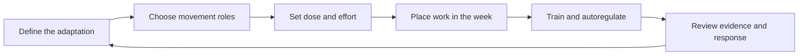

# Fitness Learning Lab

A practical curriculum for becoming able to plan, run, and revise training
without outsourcing every decision to AI.

This repository is not an exercise database and it is not a replacement for a
qualified clinician or coach. It teaches a repeatable decision process:

## Start here

1. Read the [curriculum](CURRICULUM.md) once without trying to memorize it.
2. Learn the [programming decision loop](docs/00-programming-decision-loop.md).
3. Use the [session builder](docs/templates/session-builder.md) before your next
   gym session.
4. Review one topic per week and apply it to a real training decision.
5. Read research summaries only after understanding the decision the paper can
   inform.

## Repository map

- [Curriculum / table of contents](CURRICULUM.md)
- [Programming decision loop](docs/00-programming-decision-loop.md)
- [Exercise selection](docs/01-exercise-selection.md)
- [Dose, progression, and autoregulation](docs/02-dose-progression-autoregulation.md)
- [Session and weekly structure](docs/03-session-and-weekly-structure.md)
- [Skill, power, mobility, and tendon work](docs/04-athletic-skill-and-capacity.md)
- [Framework catalogue](docs/frameworks/catalogue.md)
- [Nutrition foundations](docs/nutrition/foundations.md)
- [Supplement decision guide](docs/supplements/decision-guide.md)
- [How to read research](docs/research/how-to-read.md)
- [Research summaries](docs/research/paper-summaries.md)
- [Session builder](docs/templates/session-builder.md)
- [Weekly review](docs/templates/weekly-review.md)

## Evidence labels

- **High confidence:** converging reviews/position stands and good directness.
- **Moderate confidence:** useful evidence with population or method limits.
- **Tentative:** plausible or emerging; treat as an experiment, not a rule.
- **Personal heuristic:** a useful decision aid that must be tested against your
  own response.

The goal is informed independence: AI can help retrieve, compare, or critique,
but you remain responsible for the objective, tradeoffs, and final decision.

