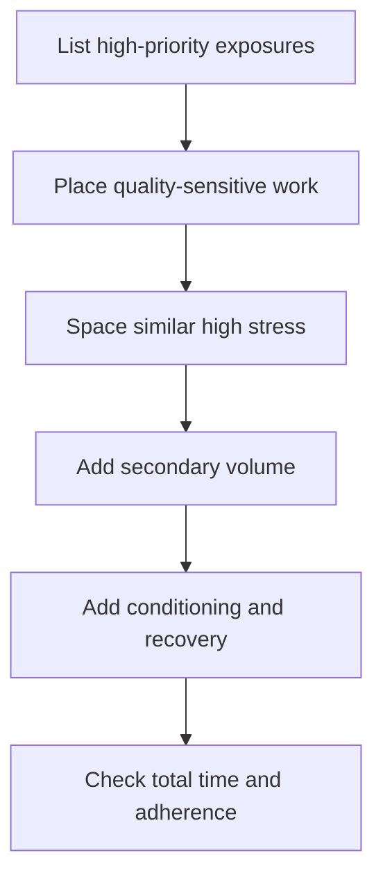

# The programming decision loop

Programming is constrained decision-making, not finding the perfect routine.

## 1. State the outcome

Write one sentence: “During this block I want to improve **X**, measured or
observed by **Y**, while maintaining **Z**.” Avoid naming an exercise as the
adaptation. A heavier squat can reflect squat skill and strength; it is not the
same statement as “improve lower-body force production for jumping.”

## 2. Identify constraints

- available days and session length
- equipment and environment
- current skill and tissue tolerance
- other sports or high-fatigue work
- movements that are painful, unreliable, or not yet understood
- what must only be maintained

## 3. Assign movement roles

Each item should have one primary role. If everything is “important,” nothing
has priority.

| Role | Question | Typical count in a session |
|---|---|---:|
| Outcome / primary | What most directly trains the block objective? | 1–2 |
| Skill | What needs high-quality practice while fresh? | 0–2 |
| Builder / secondary | What adds useful volume with manageable cost? | 1–3 |
| Capacity / prehab | What tissue or range needs gradual exposure? | 0–2 |
| Conditioning | What energy-system objective is being trained? | 0–1 |

## 4. Prescribe the smallest effective dose

Start with enough work to produce practice and progression, not the most work
you can survive. Define the variable that will progress and the stop condition
for the day.

## 5. Place stress across the week

## 6. Run, record, review

Record only what informs a decision: dose completed, effort/quality, symptoms,
and one useful note. Review trends after multiple exposures. Change early for a
clear safety/tolerance problem; otherwise avoid redesigning the plan because of
one noisy day.

## The five-question gym check

1. What is today’s priority?
2. What quality tells me it is going well?
3. What dose am I aiming for?
4. What makes me stop, regress, or substitute?
5. What single note will help next time?

