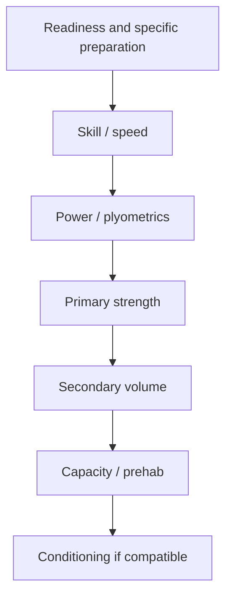

# Session and weekly structure

## Session ordering heuristic

This is a priority heuristic, not a law. Place the work that most needs
freshness and coordination early. Superset compatible low-skill work when time
is the binding constraint.

## Weekly design

1. Place the most important two to four exposures.
2. Space exposures that create similar high fatigue or tissue stress.
3. Add lower-cost practice and maintenance.
4. Add conditioning in a modality and location that preserve priority work.
5. Check whether the week is realistic, not merely elegant.

## Split choices

- **Full body:** useful for frequent practice, flexible attendance, and modest
  per-session volume.
- **Upper/lower:** simple fatigue grouping and enough frequency for most goals.
- **Push/pull/legs:** convenient for higher bodybuilding volume; missed days
  can distort frequency.
- **High/low:** groups high neural/mechanical stress on hard days and preserves
  genuinely easier days.
- **Menu-based sessions:** useful when location/readiness varies; define the
  priority and “choose 1–3” options rather than improvising everything.

## Concurrent training check

Strength/power and endurance can coexist. Manage the collision by clarifying
priority, total dose, modality, spacing, and fatigue. The question is rarely
“Can I do both?”; it is “Which quality must remain high, and what endurance dose
can I recover from?”

