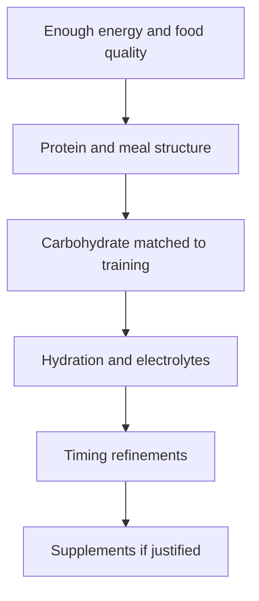

# Nutrition foundations for training decisions

## Priority order

## Energy availability

Training adaptation needs energy. Persistent under-fueling can impair recovery,
performance, health, and adherence. Body-composition goals should be balanced
against training quality and the risk of making intake unnecessarily rigid.

## Protein

Think first about consistent daily intake and several protein-containing meals,
then refine timing. Needs vary with body size, total energy, training, and
dietary pattern. A 2017 ISSN position stand identifies roughly 1.4–2.0 g/kg/day
as sufficient for most exercising people; treat that as a broad evidence-based
range, not a personalized prescription.

## Carbohydrate

Carbohydrate supports high-intensity work and glycogen-demanding volume. Match
it to session duration/intensity and the surrounding training week instead of
labeling it universally good or bad.

## Fat and micronutrients

Maintain adequate fat and dietary variety. Food-first intake also supplies
fiber and micronutrients that a macro-only plan misses. Suspected deficiencies
belong in an appropriate clinical conversation and, when relevant, testing.

## Hydration

Use thirst, climate, sweat rate, session length, and body-mass change as context.
Long/hot sessions may require planned fluid and sodium; more is not always
better. Avoid turning a general guideline into a forced universal volume.

## Gym decision checklist

- Have I eaten enough across the last day or two to support this session?
- Does this session benefit from carbohydrate before/during it?
- Is hydration unusually challenging today?
- Is a food-based option sufficient?
- Am I changing nutrition to solve a training problem that is actually poor
  sleep, excessive volume, or inconsistent attendance?

