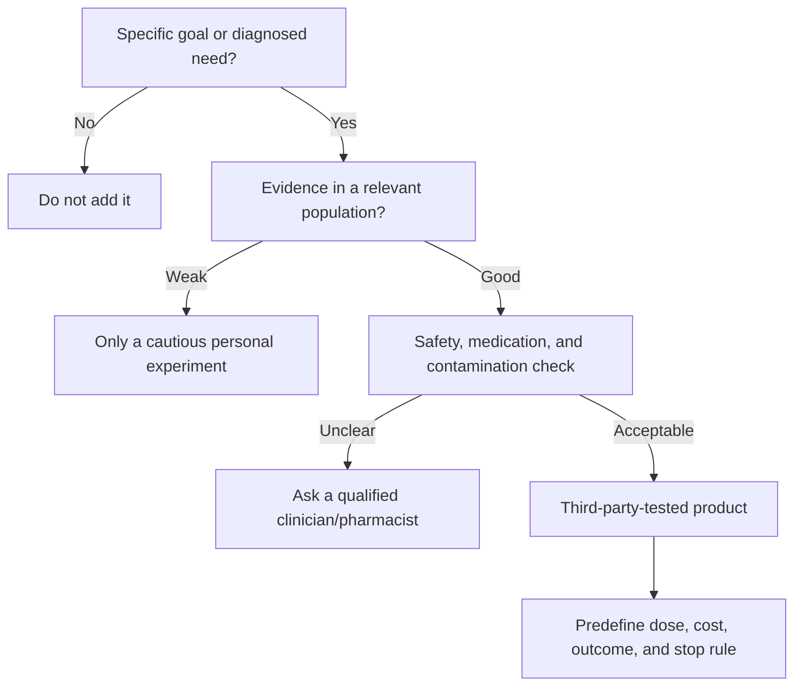

# Supplement decision guide

Supplements are optional tools after training, sleep, and nutrition basics.

## Evidence tiers

### Stronger, context-dependent evidence

- **Creatine monohydrate:** useful for repeated high-intensity training and
  strength/lean-mass outcomes; the studied ingredient matters more than exotic
  formulations.
- **Caffeine:** can acutely improve performance for many people, but response,
  sleep cost, anxiety, habituation, and timing matter.
- **Protein powder:** convenience food when normal meals do not meet the plan;
  not inherently better than food protein.

### Useful in narrower contexts

- **Beta-alanine:** most relevant to repeated/high-intensity efforts where
  acidosis contributes; paresthesia and multi-week dosing affect practicality.
- **Nitrate/beetroot:** performance effects vary by event, training status, and
  protocol.
- **Electrolyte/carbohydrate products:** useful when duration, heat, sweat, or
  rapid fueling makes them appropriate.

### Deficiency/clinical context first

Iron, vitamin D, B12, and similar nutrients should not be guessed at from
fatigue alone. Testing, diet context, symptoms, and clinician guidance matter.

## Product quality

Prefer independent certification intended to reduce contamination/banned-
substance risk. Certification does not prove that a product is effective; it
addresses a different question.

## Personal experiment card

- target outcome
- evidence and relevant population
- exact product and dose
- expected benefit and time horizon
- safety/interactions checked
- measurement method
- cost
- stop rule

